# A spinning porous-blade deaerator, from scratch in Fluent

**Computational Fluid Dynamics, experiential learning (EL)** · RV College of Engineering, Bengaluru ·
6th semester, 2025–26 · guided by Bhaskar K

**Akula Uday Kiran · Kiran V Airani · Nidhi Nagavi · Rohit Kadakol**

The problem statement was short: a deaerator for the fuel and water separation system of the
LCA Tejas, the fighter, modelled for a liquid and air. A deaerator separates a mixture by spinning it,
here through a rotating porous blade. That was all we were given. Everything else we had to decode
ourselves: what the device should look like, how to cut it down to something we could mesh and run,
how to make Fluent turn a porous blade, how to handle two phases at once, and how to use Fluent's
periodic boundaries so that a quarter of the disc could stand for the whole of it.

We built it in the last days of June 2026. It is a simple project, but it was the first time we set up
a rotating, porous, two-phase case from nothing, and it is worth keeping.

<p align="center">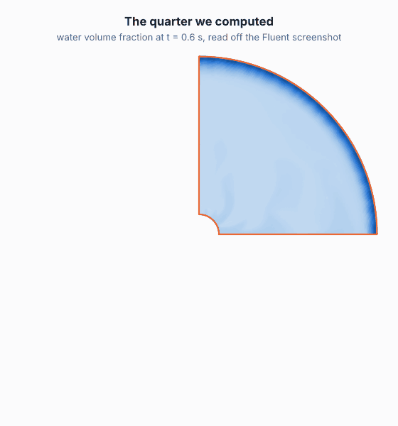<br>
<sub>The quarter we computed, copied round the disc by periodicity and then turning with the rotor. The
colour is the water volume fraction at t = 0.6 s, read off the colours of our Fluent screenshot: water
thrown out to the casing, air left in the core.</sub></p>

| | |
|---|---|
| **Problem** | a deaerator for an aircraft fuel system, modelled as a rotating porous blade that separates a water–air mixture |
| **Domain** | 2-D, a 90° sector of the disc: inlet at r = 10 mm, porous rotor out to 49 mm, a 1 mm gap, a stationary casing at 50 mm |
| **Mesh** | structured, made in Pointwise, 41,392 quadrilaterals; one grid, labelled five ways in 53 minutes |
| **Physics** | ANSYS Fluent 2024 R1: mixture model (water and air), a porous zone turning at 1000 rpm in a rotating reference frame, rotational periodicity |
| **Run** | as our slides record it: 5,000 steady iterations to start, then 0.6 s of transient flow in 3,600 steps of 1° of rotation |
| **Result** | at 0.6 s the water had gathered in a layer about 2 mm thick on the casing, and the rest of the sector held about a fifth water (read off our screenshots) |
| **Done** | 27 to 30 June 2026, four students |
| **Checked** | November 2026: the hand calculation re-done, the meshes measured, the result read back off the screenshots. [What we found](#what-we-checked-in-november-2026) |

---

## What a deaerator does

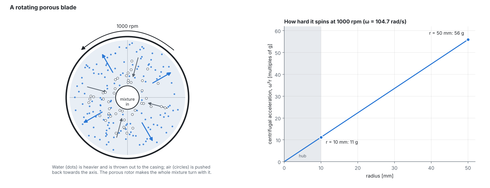

A mixture of liquid and air comes in at the middle of a spinning disc. The disc is a porous blade: a
solid, sponge-like rotor that the mixture flows through, and that drags the mixture round with it. At
1000 rpm the mixture feels 11 g at 10 mm from the axis and 56 g at the rim, 50 mm out. Water is about 815
times denser than air, so it is thrown outwards against the casing, while the air is pushed back
towards the axis, where it can be drawn off. In a fuel system the liquid is the fuel, and the air is
what has to come out of it.

## The model

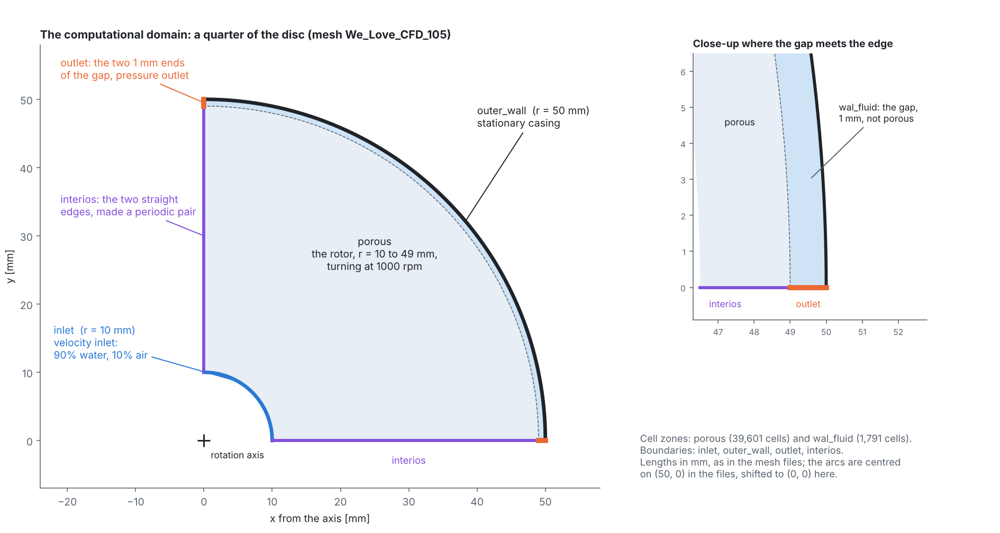

This is what we made of the problem statement: a two-dimensional slice through the disc, cut down to a
quarter.

| Zone or boundary | Type in the mesh | Where | Size |
|---|---|---|---|
| `porous` | fluid (cell zone) | the rotor, r = 10 to 49 mm, turning at 1000 rpm, with porous resistance | 39,601 cells |
| `wal_fluid` | fluid (cell zone) | the 1 mm gap between the rotor and the casing, r = 49 to 50 mm | 1,791 cells |
| `inlet` | velocity inlet | the inner arc, r = 10 mm: 90% water and 10% air by volume | 199 faces, 15.7 mm |
| `outer_wall` | wall | the casing, r = 50 mm, stationary | 199 faces, 78.5 mm |
| `outlet` | pressure outlet | the two 1 mm ends of the gap, where the water layer can leave | 18 faces, 2 mm |
| `interios` | interior, then periodic | the two straight edges, r = 10 to 49 mm | 398 faces, 2 × 39 mm |

These are the meshes of 27 June, which we still have. The contours from 29 June come from a later mesh
with a smaller hub: its inlet sits at a tenth of the outer radius rather than a fifth, which is
r = 5 mm if the casing stayed at 50 mm. That mesh was not kept.

## One quarter for the whole disc

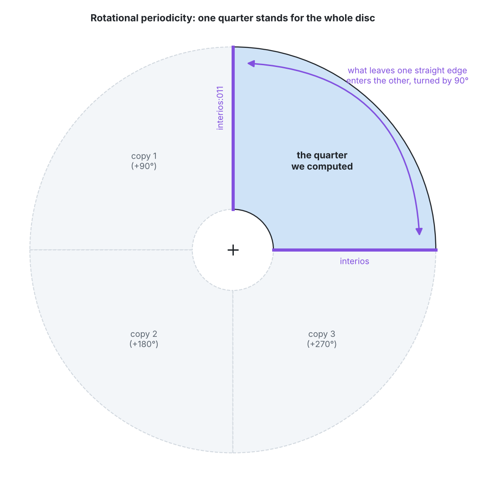

The device is the same all the way round, so the flow in one quarter repeats in the next. Fluent's
rotational periodic boundaries make that exact: whatever leaves through one straight edge comes back
in through the other, turned by 90°. The mesh then only has to cover a quarter of the disc.

Finding out how to do this took us several tries, and the mesh files keep them. In Pointwise we
first left the straight edges as walls, then labelled them as a recirculation outlet and inlet, and
finally as a plain interior zone, `interios`. In Fluent that zone was split into its two edges (Fluent
names the second half `interios:011`) and the halves were joined as a rotational periodic pair, as the
boundary table on slide 8 records. Fluent will only do that if the two edges match node for node
when one is turned onto the other, and ours do: 199 faces each, spaced the same way.

## The mesh

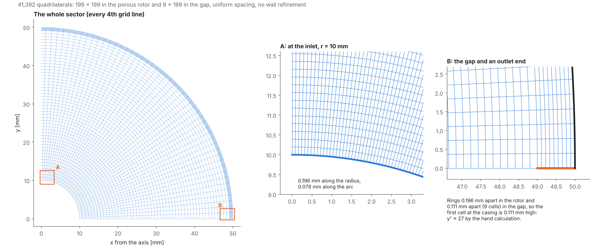

The grid is structured and polar: 199 cells across the radius and 199 round the arc in the rotor, and
9 by 199 in the gap, 41,392 quadrilaterals in all. The spacing is uniform: 0.196 mm between rings in the
rotor, 0.111 mm in the gap, and 0.452° between rays (0.079 mm apart at the inlet, 0.39 mm at the
casing). The first cell at the casing is therefore 0.111 mm high, and no cell is more than 3.6 times
longer than it is wide. This is the uniform mesh we started from ("case 0"). On 29 June a second mesh followed, with a
0.02 mm first cell at the wall; it was not kept.

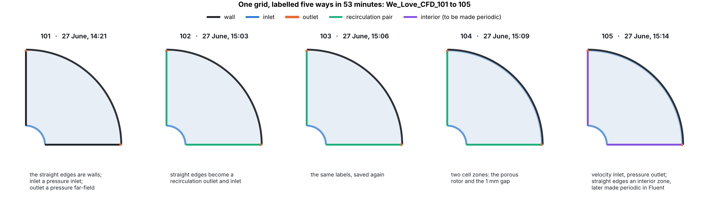

All five files in [`mesh/`](mesh) hold exactly the same grid; what changes from one to the next is how
its boundaries and zones are labelled. They were exported from Pointwise between 14:21 and 15:14 on
27 June, and the Pointwise project, saved at 15:59, carries the final labelling of `105`.

| File | Exported | Labels |
|---|---|---|
| `We_Love_CFD_101` | 14:21 | one fluid zone; straight edges and casing are walls; inlet a pressure inlet; outlet a pressure far-field |
| `We_Love_CFD_102` | 15:03 | the straight edges become a recirculation outlet and inlet; the casing becomes `outer_wall` |
| `We_Love_CFD_103` | 15:06 | the same labels as 102 |
| `We_Love_CFD_104` | 15:09 | two cell zones: `porous` (the rotor) and `wal_fluid` (the gap) |
| `We_Love_CFD_105` | 15:14 | velocity inlet, pressure outlet, and the straight edges as one interior zone, `interios`, to be made periodic in Fluent |

## Sizing the first cell by hand

<p align="center">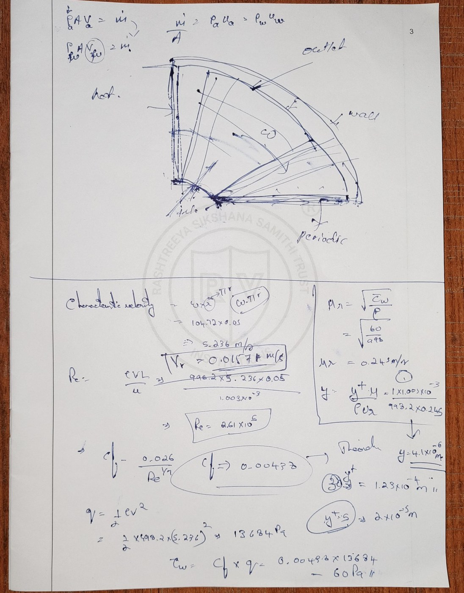<br>
<sub>Our working, 29 June 2026: the sector with its inlet, outlet, wall and periodic edges at the top, and
the first-cell height below.</sub></p>

Before meshing the wall properly we worked out how thick the first cell should be, by hand:

```
omega = 2 pi x 1000 / 60                                  = 104.72 rad/s
V     = omega r = 104.72 x 0.05                           = 5.236 m/s     speed of the rim
Re    = rho V L / mu = 998.2 x 5.236 x 0.05 / 1.003e-3    = 2.61 x 10^5
Cf    = 0.026 / Re^(1/7)                                  = 0.00438       turbulent flat plate
q     = rho V^2 / 2 = 0.5 x 998.2 x 5.236^2               = 13,684 Pa
tau_w = Cf q = 0.00438 x 13,684                           = 60 Pa
u_tau = sqrt(tau_w / rho) = sqrt(60 / 998.2)              = 0.245 m/s
y     = y+ mu / (rho u_tau)                               = 4.1 um for y+ = 1
                                                            20 um for y+ = 5
                                                           123 um for y+ = 30
```

Every number checks out; [`deaerator/calc.py`](deaerator/calc.py) repeats the working and gets the same
values. More on it in [`calculations/`](calculations/README.md).

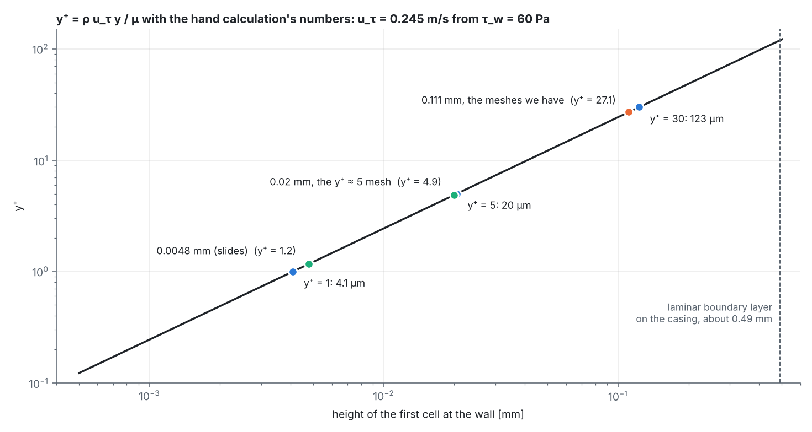

On that line, the uniform mesh we have, with its 0.111 mm first cell, sits at y⁺ ≈ 27. The 0.02 mm mesh of
29 June sits at y⁺ ≈ 5, and the 0.0048 mm the slides quote would be y⁺ ≈ 1.2.

## Setting up Fluent

<p align="center">
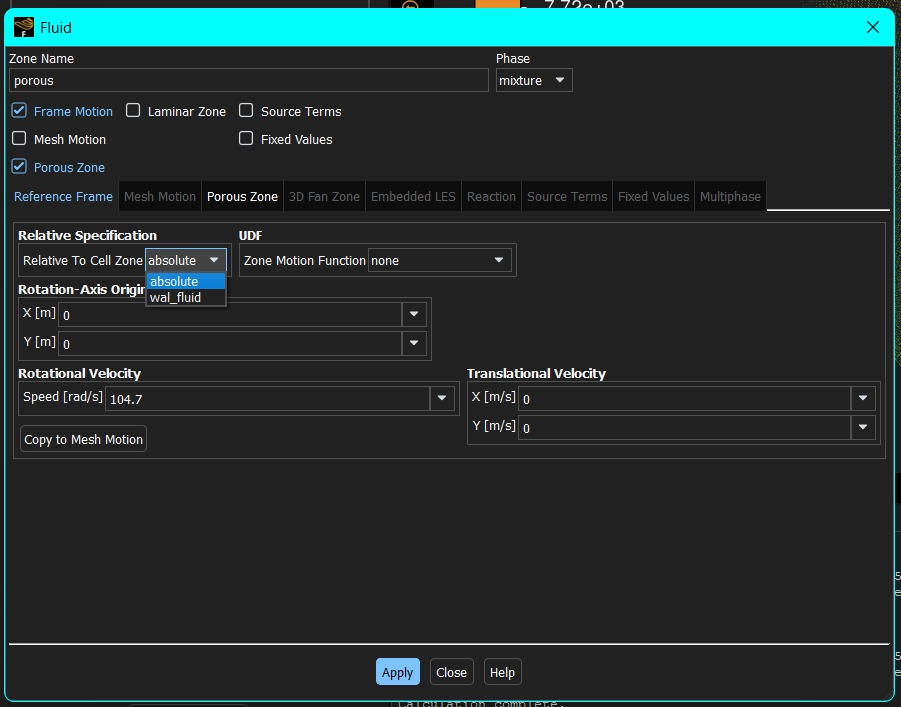
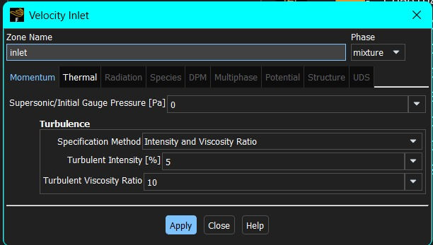<br>
<sub>The evening of 27 June. Left: the porous zone with frame motion at 104.7 rad/s (1000 rpm). Right: the
velocity inlet. More screenshots, with the case tree and the porous settings, are in
<a href="media/README.md">media/</a>.</sub></p>

What the screenshots of 27 June show for certain:

- a 2-D, double-precision, pressure-based session with the mixture model, SST k-ω turbulence and
  8 processes (all in the window's title bar);
- `water-liquid` and `air` as the materials, and `porous` and `wal_fluid` as the cell zones;
- the porous zone with frame motion, a rotating reference frame, at 104.7 rad/s, and the porous-zone
  option on;
- a velocity inlet with turbulence set by 5% intensity and a viscosity ratio of 10.

What our slides record for the final runs:

- the mixture model with water as the primary phase and air as the secondary one, with body force and
  slip velocity switched on;
- laminar flow;
- a porous viscous resistance of 1.8 × 10¹¹ m⁻²;
- a steady start of 5,000 iterations: 1,500 with first-order upwinding, then 3,500 with second-order;
- then a transient run with a time step of 1.67 × 10⁻⁴ s, which is 1° of rotation at 1000 rpm, for 0.6 s:
  ten turns, 3,600 steps;
- wall shear stress and skin friction taken as area-weighted averages.

Some other lines on the slides describe settings we cannot have used. They are listed
[below](#what-we-checked-in-november-2026).

<p align="center">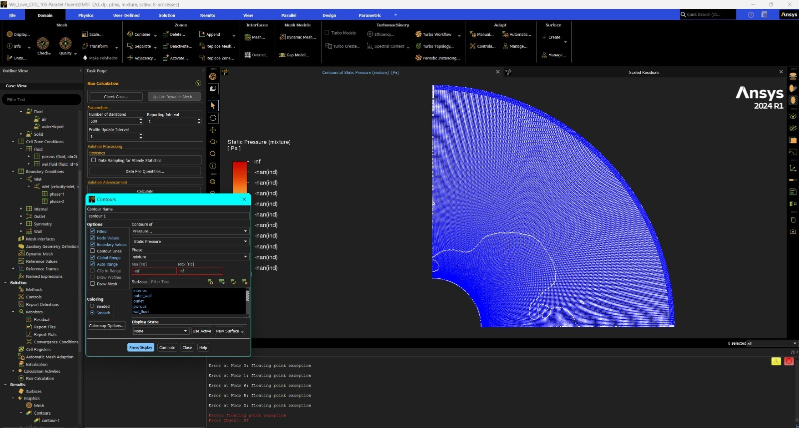<br>
<sub>21:27 on 27 June: the first run. The pressure contour legend reads <code>inf</code> and
<code>-nan(ind)</code>, and the console fills with floating-point exceptions.</sub></p>

## What came out

<p align="center">
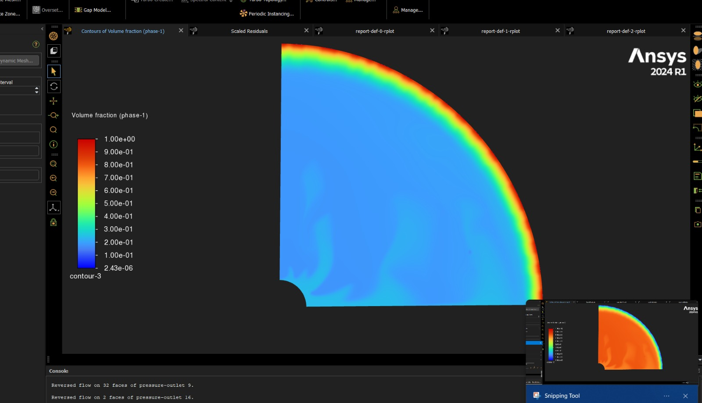
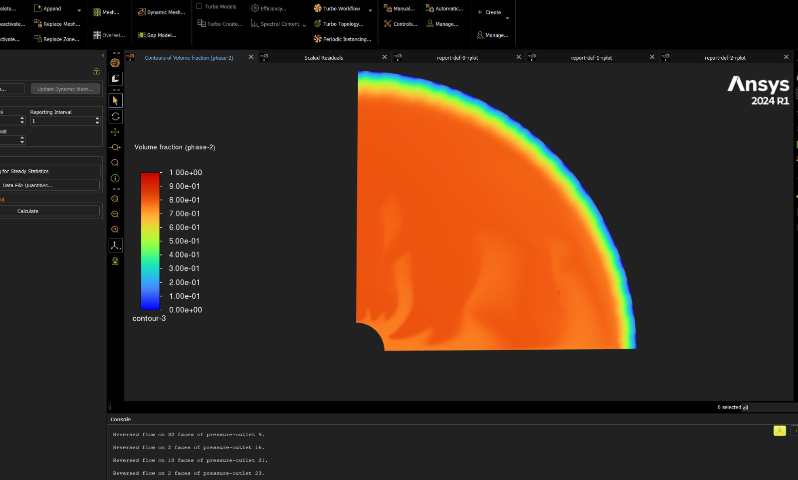<br>
<sub>29 June: volume fraction of water (phase-1, left) and of air (phase-2, right) at t = 0.6 s, as we
saved them from Fluent. These two screenshots are all that is left of the result.</sub></p>

The case and data files behind these contours were not kept, so to say anything more about the result
we read the values back off the screenshots' colours, matching each pixel to the colour bar
([`deaerator/digitize.py`](deaerator/digitize.py)). With two phases the water and air fractions add up to
one, which gives a check: the water screenshot and one minus the air screenshot agree to 0.008 (rms).

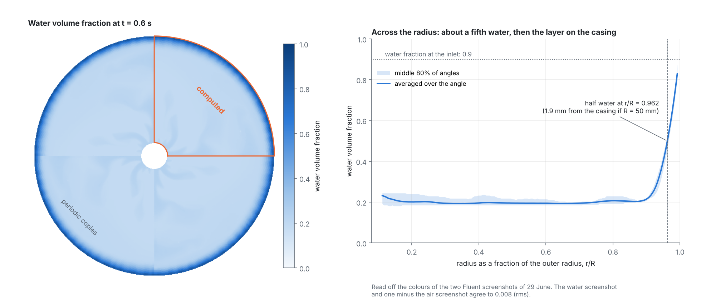

At 0.6 s the water has been thrown out to the casing. Averaged round the quarter, the water fraction
passes 0.25 at 3.8 mm from the casing and 0.5 at 1.9 mm, if the casing is at 50 mm, and reaches 0.83
just inside the casing. Over the rest of the sector it stays near 0.20 (0.193 to 0.207 between a fifth and
85% of the radius), far below the 0.90 coming in at the inlet.

We think the run simply had not gone on long enough for the inflow to replace what the sector held at
the start. Neither the initial condition nor the inlet velocity is recorded in anything we kept, so we
cannot check that. The console under the contours also reports reversed flow, fluid coming back in, on
four pressure outlets. The separation efficiency that our objectives promised is not in the slides,
and we have nothing left to compute it from.

## What we checked in November 2026

1. **The hand calculation is right.** Every step reproduces, from the tip speed to the first-cell
   heights ([`deaerator/calc.py`](deaerator/calc.py)).

2. **The meshes we have are much coarser at the wall than the calculation asked for.** Their first cell
   is 0.111 mm high, which is y⁺ ≈ 27 by our own numbers, not y⁺ = 1. The later meshes of 29 and 30 June
   were not kept.

3. **The skin-friction formula is a turbulent one.** Cf = 0.026 Re^(−1/7) is a fit for turbulent
   flat-plate flow, used here at Re = 2.6 × 10⁵, where a flat plate would normally still be laminar,
   and for a run the slides call laminar. It is a cautious way to size a first cell, but it does not
   go with "laminar". For laminar flow the yardstick is the boundary layer, about 0.49 mm thick on the
   casing (5L/√Re), and the uniform mesh puts about four cells across it.

4. **The slides say density-based solver.** Fluent runs the mixture model only with the
   pressure-based solver, and the session of 27 June was pressure-based.

5. **Laminar, or SST k-ω?** The slides say laminar. The session of 27 June ran SST k-ω, with turbulence
   specified at the inlet. Which model the final run used is not recorded anywhere.

6. **Slides 9 and 10 describe a model we did not build:** two outlets, one on a 270°–360° arc and one
   near the shaft, a rotating shaft wall, a sliding interface, and three cell zones, two of them with
   mesh motion.
   None of these exist in our meshes, which have one outlet, periodic edges and two cell zones. The
   screenshots show frame motion, which is also what the slides' own title, the Multiple Reference
   Frame method, means.

7. **The boundary table on slide 8 has the wrong radii.** It gives the outer arc as R = 10 mm, the
   porous zone as 5 to 9 mm, and `wal_fluid` as an inner core from 0 to 5 mm. In the meshes the casing
   is at 50 mm, the porous rotor runs from 10 to 49 mm, and `wal_fluid` is the 1 mm gap at the casing.
   The contours' proportions fit an inlet at 5 mm with the casing at 50 mm, not at 10 mm.

8. **The first-cell height was never written down.** Slide 5 leaves the final value blank
   ("Δy = mm"), slide 4 says it converged to 0.0048 mm, and no mesh with that spacing survives. A
   grid-independence study is in the plan, but none made it into the slides.

9. **The rotation axis may have been in the wrong place on 27 June.** The meshes have their arcs
   centred at (50, 0) mm, while the screenshots of that evening show the rotating frame's axis at
   (0, 0). Unless the mesh was moved in Fluent, which nothing records, the frame turned about a point
   50 mm from the sector's own axis. We cannot tell whether that was put right later.

## What we learned

- Turning a one-line problem statement into a model is most of the work: choosing the domain, the
  zones and the boundaries comes before any equation.
- Periodic boundaries let a quarter stand for the whole, but only when the two edges match and the axis
  is right. We found that out by labelling the same grid several ways.
- Write down the settings of the run you report. Our slides ended up describing settings we never used,
  and the files that would settle it are gone.
- Keep the case and data files. Two screenshots were all that survived of our result.

## Timeline

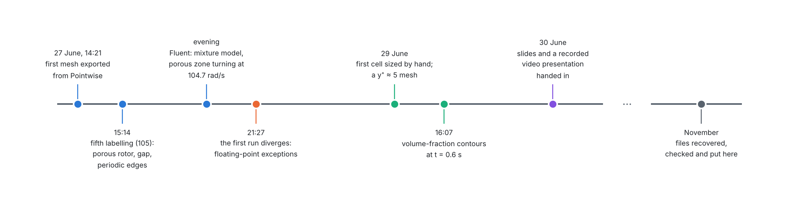

| When | What |
|---|---|
| 27 June 2026, 14:21 to 15:14 | one structured grid exported from Pointwise five times, labelled differently each time (`101` to `105`) |
| 27 June, 15:59 | the Pointwise project saved (`101.pw`) |
| 27 June, evening | Fluent set up: the mixture model, and the porous rotor turning at 104.7 rad/s; at 21:27 the first run diverges |
| 29 June | the first-cell height worked out by hand; a mesh with a 0.02 mm first cell; the volume-fraction contours at t = 0.6 s |
| 30 June | the slides and a recorded video presentation handed in; more cases run that afternoon |
| November 2026 | the files recovered and checked, and this repository put together |

## Run it yourself

Python 3 with numpy, matplotlib and Pillow (`pip install -r requirements.txt`). From the top folder:

```
python tools/check.py                              # every number in this README, recomputed
python tools/make_figures.py                       # redraws everything in figures/
python -m deaerator.calc                           # the hand calculation, step by step
python -m deaerator.mesh mesh/We_Love_CFD_105.cas.gz
```

To open the mesh in Fluent, read `mesh/We_Love_CFD_105.cas.gz` directly; Fluent reads gzipped files.
The coordinates are in millimetres. [`setup/`](setup/README.md) walks through rebuilding the case, and
says which settings we know and which we do not.

## What's in this repository

```
mesh/          the five Pointwise exports (We_Love_CFD_101 to 105, gzipped) and the Pointwise project
setup/         rebuilding the Fluent case: what we know, what we don't
calculations/  the hand calculation of the first-cell height, photographed and explained
media/         Fluent screenshots from 27 and 29 June, and a preview of the slides
slides/        the presentation (PowerPoint and PDF), with corrections
deaerator/     Python: the mesh reader, the hand calculation, reading values off the screenshots
tools/         check.py (the numbers) and make_figures.py (the figures)
figures/       the figures in these pages, drawn by tools/make_figures.py
```

## The slides

[`slides/`](slides/README.md) has the presentation we handed in on 30 June, as a PowerPoint file and as a
PDF, with a list of what it gets wrong.

<p align="center">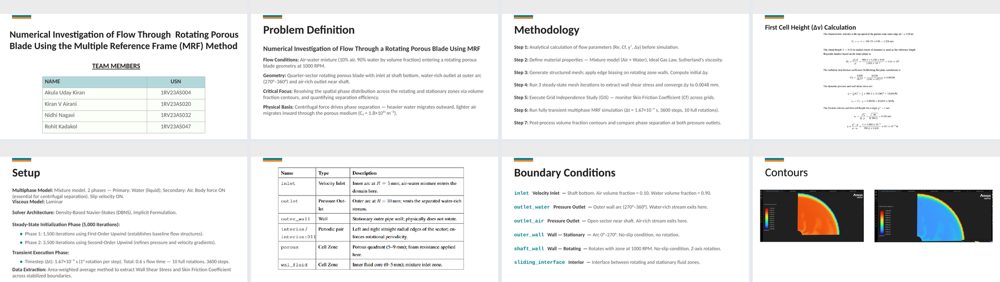</p>

---

## Team

**Akula Uday Kiran**, **Kiran V Airani**, **Nidhi Nagavi** and **Rohit Kadakol**, Department of Aerospace
Engineering, RV College of Engineering, Bengaluru. Guided by **Bhaskar K**, Assistant Professor.

We did it together, in a few days. Thank you to Bhaskar K sir for guiding it. Uday has learnt from him
for a long time.

This repository was put together in November 2026 from our meshes, screenshots, working and slides. The
checks, the code, the figures and these notes were written then.

## License

The code (`deaerator/` and `tools/`) is MIT-licensed ([LICENSE](LICENSE)). The meshes, the Pointwise
project, the screenshots, the hand calculation and the slides are the team's own work.
