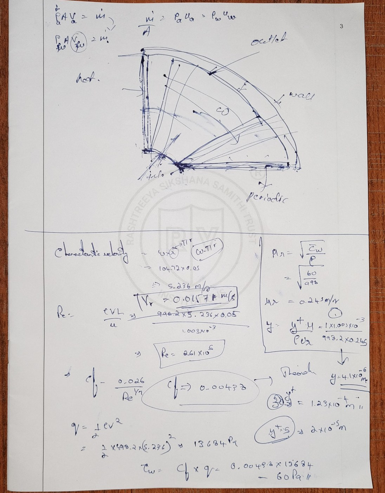

# The first-cell height, by hand

Our working of 29 June 2026, on one sheet. At the top, the sector as we drew it: the inlet at the hub,
the outlet and the wall at the outer arc, and the periodic edges. At the bottom, the height of the first
cell at the wall.

## The working

| Step | Formula | Value |
|---|---|---|
| angular speed | ω = 2π × 1000 / 60 | 104.72 rad/s |
| velocity scale: the rim's speed | V = ω r = 104.72 × 0.05 | 5.236 m/s |
| Reynolds number, with L = r = 0.05 m and water at about 20 °C | Re = ρ V L / μ = 998.2 × 5.236 × 0.05 / 1.003 × 10⁻³ | 2.61 × 10⁵ |
| skin friction, turbulent flat plate | Cf = 0.026 / Re^(1/7) | 0.00438 |
| dynamic pressure | q = ½ ρ V² | 13,684 Pa |
| wall shear stress | τw = Cf q | 60 Pa |
| friction velocity | uτ = √(τw / ρ) = √(60 / 998.2) | 0.245 m/s |
| first-cell height | y = y⁺ μ / (ρ uτ) | 4.1 μm for y⁺ = 1, 20 μm for y⁺ = 5, 123 μm for y⁺ = 30 |

`python -m deaerator.calc` repeats every step and gets the same numbers (q comes out at 13,683 Pa, a
rounding difference).

## Two notes from November 2026

- **The formula for Cf is a turbulent one**, a fit for turbulent flow over a flat plate. At
  Re = 2.6 × 10⁵ a flat plate would normally still be laminar, and the slides call the run laminar. As a
  cautious way to size a first cell it is fine. For laminar flow the better yardstick is the thickness of
  the boundary layer, about 5L/√Re = 0.49 mm on the casing.
- **The meshes we have don't use the result.** Their first cell at the casing is 0.111 mm, which is
  y⁺ ≈ 27 by these numbers. A mesh with a 0.02 mm first cell (y⁺ ≈ 5) followed on 29 June, and the
  slides quote 0.0048 mm (y⁺ ≈ 1.2) as the converged value; neither of those meshes was kept.

The sheet also has, at the top left, the mass-flow balance written out for each phase
(ρ A V = ṁ, so ṁ / A = ρ_a u_a = ρ_w u_w), and a boxed V_r = 0.0157 m/s next to the velocity scale. What
V_r stood for is not written down. It happens to equal the length of the inlet arc of the meshes we
have, π/2 × 10 mm = 15.7 mm, so we have not used it.
